# SafeRoute: Context-Aware Personal Safety Routing, Dynamic Risk Graph Formulation & Emergency Navigation System

**SafeRoute** is an AI-driven, time-aware, personalized safe route recommendation, live turn-by-turn navigation, and tactical emergency response platform engineered specifically for the metropolitan road network of Chennai, India.

It transforms OpenStreetMap (OSM) road topologies into dynamic risk graphs, applying **Pre-Search Road Memory Biasing** (penalizing avoided corridors up to 15x and discounting trusted corridors), diverse **Iterative Edge-Penalized Candidate Discovery**, real-time **TomTom Traffic Flow Telemetry**, an adaptive **Personal Digital Twin**, continuous **Tactical HUD GPS Map-Matching with Off-Route Deviation Detection**, and an integrated **Multi-Channel Emergency SOS Subsystem** with spatial nearest police station discovery and live guardian tracking tokens.

---

## 🌟 Core System Capabilities

### 1. Pre-Search Road Memory Biasing Engine (`candidate_route_engine.py`)
- **Proactive Avoidance Over Post-Hoc Filtering**: Unlike standard routing systems that evaluate personal preferences only *after* paths are discovered, SafeRoute modifies edge impedances **prior to pathfinding**:
  $$\text{route\_cost}(e) = \max(\ell(e), 1.0) \times M_{\text{memory}}(e)$$
- **Dynamic Memory Multipliers**:
  - **Critical Avoidance ($S_{\text{avoid}} \ge 0.70$):** Multiplies edge cost by **$15.0\times$**, forcing Dijkstra's algorithm to structurally detour around dangerous or reported corridors.
  - **Moderate Avoidance ($0.35 \le S_{\text{avoid}} < 0.70$):** Multiplies edge cost by **$4.0\times$**.
  - **Repeated Rejections ($N_{\text{reject}} \ge 3$):** Multiplies edge cost by **$2.0\times$** for streets the user consistently ignores.
  - **Familiar & Trusted Corridors ($S_{\text{trust}} \ge 0.70, N_{\text{visit}} \ge 2$):** Grants a **$20\%$ cost discount ($0.80\times$)**, guiding pathfinding through corridors the user knows and feels comfortable traversing.

### 2. Diverse Candidate Route Discovery via Iterative Edge Penalization
- **High-Fidelity Road Network**: In-memory directed graph of Chennai road topology with node snapping, one-way dead-end recovery, and adjacent graph fallbacks.
- **Iterative Penalization (Algorithm 4.1)**: Discovers 7 to 20 candidate paths bounded by a strict distance factor ($D_{\text{max}} = 1.45 \times D_{\text{shortest}}$). After each accepted route, its constituent edges are penalized by $1.25\times$.
- **Jaccard Overlap Filtering**: Filters out redundant paths with edge Jaccard similarity $> 0.90$, presenting genuinely distinct geographic alternatives.

### 3. Multi-Criteria Hybrid Safety Scoring & Live Traffic Telemetry (`final_route_engine.py`)
- **Multi-Source Built Environment Modeling**:
  - Street illumination from OSM lighting tags (`lit=yes` vs `lit=no`);
  - Road hierarchy (dual-carriageway primary vs. narrow residential alley);
  - Spatial proximity bonus to certified police stations ($1.5\,\text{km}$ decay radius);
  - Bivariate Gaussian kernel crime hotspot density.
- **Live TomTom Traffic Flow Telemetry**: Queries real-time vehicle velocity $v_{\text{curr}}$ and free-flow velocity $v_{\text{free}}$ to assess street isolation and stagnation. Avoids deserted roadways late at night while penalizing severe gridlocks.
- **Dynamic Weight Renormalisation**: Automatically renormalises scoring weights across active signals if traffic APIs experience transient network outages.
- **Pareto-Optimal Archetype Classification**: Categorizes candidates into:
  - 🟢 **Safest Route**: Maximum illumination, wide thoroughfares, and police proximity (highest Safety Score).
  - 🟡 **Balanced Route**: Optimal compromise between transit duration and safety score.
  - 🟠 **Fastest Route**: Minimum physical travel duration.

### 4. Personal Digital Twin & Traversal Memory Lifecycle (`personal_twin_engine.py`, `segment_memory_service.py`)
- **Demographic Vulnerability Curve**: Dynamically tunes safety weights based on age, gender, travel mode, and night sensitivity.
- **Automated Segment Traversal Lifecycle**:
  - Ending navigation automatically marks the trip complete in PostgreSQL (`/api/navigation/end` and `/api/trips/{trip_id}/complete`), atomically incrementing `visit_count` and updating `last_visit`.
  - Candidate route presentation tracks `selection_count` for chosen routes and `rejection_count` for unselected alternatives.
- **Post-Trip Learning Loop**: 1-tap feedback modal updates `trust_score` and `avoidance_score` in `personal_segment_memory`, immediately influencing future route recommendations.

### 5. Turn-by-Turn Tactical Navigation HUD & Deviation Sentinel (`NavigationHUD.tsx`)
- **Real-Time Kinematic Tracking**: Supports device GPS and interactive simulated on-road drive, streaming coordinates every 2 seconds via `/api/navigation/gps-stream`.
- **Cross-Track Haversine Deviation Sentinel**: Computes perpendicular distance from the planned route polyline. If drift exceeds **$45\,\text{m}$ for consecutive epochs**, the HUD sounds a warning chime and triggers automated recalculation from the live position.
- **Local Network Dynamic Host Detection**: `routeApi.ts` automatically detects LAN hostnames (e.g. `http://10.23.104.207:3000`), allowing mobile devices on the same Wi-Fi to seamlessly connect to backend services without hardcoded localhost errors.

### 6. Emergency SOS Subsystem, Synthesized Siren & Guardian Tracking (`sos_routes.py`)
- **Instant Telemetry Freeze**: Locks coordinates at the exact incident location and halts movement simulation.
- **Web Audio API Acoustic Siren**: Synthesizes an oscillating $850\,\text{Hz} - 1200\,\text{Hz}$ square/sawtooth alarm siren at maximum gain through the device speaker.
- **Spatial Nearest Police Station Discovery**: Sub-millisecond lookup across 135+ Greater Chennai Police Stations via spatial distance calculation, identifying station name, contact number, and distance.
- **Multi-Channel Alert Broadcasting**:
  - Issues 64-bit cryptographic share tokens for public tracking (`/sos/track/[token]`);
  - Dispatches carrier SMS via Twilio to registered emergency contacts;
  - Generates 1-click WhatsApp emergency location cards;
  - Broadcasts real-time incident updates to guardian dashboards via `/api/sos/active-alerts-for-me` WebSockets.

---

## 🏗️ System Architecture & End-to-End User Journey

### 1. High-Level Layered Architecture

```text
┌─────────────────────────────────────────────────────────────────────────────┐
│                   PRESENTATION LAYER (Next.js 15 / React / Tailwind)        │
│  Origin/Dest Input  │  Ranked Route Cards  │  Tactical HUD  │ Tracking Page │
└──────────────────────────────────────┬──────────────────────────────────────┘
                                       │ HTTPS REST / WebSockets
┌──────────────────────────────────────▼──────────────────────────────────────┐
│                    API ORCHESTRATION LAYER (FastAPI Backend)                │
│  /api/routes/search  │  /api/navigation/*   │  /api/sos/*  │  /api/trips/*  │
└──────────┬───────────────────────────┬───────────────────────────┬──────────┘
           │                           │                           │
┌──────────▼───────────────┐ ┌─────────▼───────────────┐ ┌─────────▼──────────┐
│   SPATIAL GRAPH ENGINE   │ │  HYBRID RISK & TWIN     │ │ EMERGENCY SOS      │
│ - OSMnx Road Network     │ │ - TomTom Traffic Flow   │ │ - Police KD-Tree   │
│ - Pre-Search Biasing     │ │ - Diurnal Lighting      │ │ - Acoustic Siren   │
│ - Penalized Dijkstra     │ │ - Personal Twin Memory  │ │ - Twilio/WhatsApp  │
└──────────┬───────────────┘ └─────────┬───────────────┘ └─────────┬──────────┘
           │                           │                           │
┌──────────▼───────────────────────────▼───────────────────────────▼──────────┐
│                         DATA PERSISTENCE & CACHING LAYER                    │
│  PostgreSQL / SQLite  │  personal_segment_memory  │  In-Memory OSM Cache    │
└─────────────────────────────────────────────────────────────────────────────┘
```

### 2. Complete End-to-End Operational Workflow Diagram

```mermaid
flowchart TD

  %% ─────────────────────────────────────────
  %% 1. LOGIN
  %% ─────────────────────────────────────────
  A(["👤 User Opens SafeRoute\n(Browser / Mobile)"]) --> B

  subgraph AUTH["1️⃣  Authentication & Onboarding"]
    B["AuthModal — Enter email + password\n+ Add Trusted Emergency Contacts\n+ Set Safety Preferences sliders"]
    B --> C["POST /api/auth/register OR /api/auth/login"]
    C --> D["security.py → bcrypt verify\nJWT token issued"]
    D --> E[("PostgreSQL\nusers · personal_preferences\nPersonalTwinState · TrustedContacts")]
  end

  E --> F

  %% ─────────────────────────────────────────
  %% 2. ROUTE SEARCH
  %% ─────────────────────────────────────────
  subgraph SEARCH["2️⃣  Route Search  —  SearchPanel.tsx"]
    F["User enters:\n📍 Origin (e.g. Chennai Central)\n📍 Destination (e.g. Marina Beach)\n🕐 Departure time"]
    F --> G["POST /api/routes/search\nroutes.py"]
  end

  %% ─────────────────────────────────────────
  %% 3. INTERNAL ROUTE ENGINE PIPELINE
  %% ─────────────────────────────────────────
  G --> H

  subgraph PIPELINE["3️⃣  Internal Route Generation Pipeline"]
    direction TB

    H["🗺️  STEP 1 — Geocoding\ngeocoder.py\nNominatim API → lat/lon\nChennai landmark fallback dict"]

    H --> I["📌  STEP 2 — Node Snapping\nroute_engine.py\nSnap lat/lon → nearest OSM node\nin in-memory 68,667-node DiGraph"]

    I --> J["🧠  STEP 3 — Pre-Search Memory Biasing\ncandidate_route_engine.py\nFor every road edge e:\n  avoidance ≥ 0.70  →  15× cost ⛔\n  avoidance ≥ 0.35  →   4× cost 🔴\n  rejections ≥ 3    →   2× cost 🟠\n  trust+visits ≥ 2  →  0.80× cost 🟢"]

    J --> K["🔀  STEP 4 — Iterative Edge-Penalized\nCandidate Discovery\ncandidate_route_engine.py\nDijkstra on biased graph → Path R₀\nD_max = 1.45 × D₀\nPenalize edges × 1.25 per accepted route\nJaccard overlap ≤ 0.90 filter\n→ 7–20 Diverse Candidate Paths"]

    K --> L["⚠️  STEP 5 — Hybrid Risk Scoring\nroute_scoring.py + risk_engine.py\nosm_hybrid_risk.pkl + ml_engine.py\n35-Feature LightGBM base score\n• Street Lighting  (OSM lit tags)\n• Road Hierarchy   (primary→alley)\n• Crime Density    (kernel clusters)\n• Police Proximity (1.5 km decay)"]

    L --> M["🕐  STEP 6 — Time-of-Day Multiplier\ntime_risk_engine.py\nDaytime  → 1.00×\nEvening  → 1.35×\nNight    → 1.75×\nLate Night → 2.20×"]

    M --> N["🚗  STEP 7 — Live Traffic Telemetry\ntraffic_engine.py\nTomTom Traffic Flow API\nv_curr / v_free per segment\nGridlock → 1.40×  Deserted → 1.30×\nFlowing  → 0.85×  Offline → diurnal fallback"]

    N --> O["👤  STEP 8 — Personal Twin Calibration\npersonal_twin_engine.py\nBlend explicit prefs + learned Twin weights\nVulnerability curve (age, gender, mode)\nPersonal risk offset R_personal ∈ [-15, +25]"]

    O --> P["🏆  STEP 9 — Pareto Multi-Criteria Ranking\nfinal_route_engine.py\nComposite Safety Score = 0–100\nAssign archetypes:\n🟢 Safest  🟡 Balanced  🟠 Fastest"]
  end

  %% ─────────────────────────────────────────
  %% 4. DISPLAY ROUTES
  %% ─────────────────────────────────────────
  P --> Q

  subgraph DISPLAY["4️⃣  Route Display  —  RouteList / RouteDetails / SafeRouteMap"]
    Q["Ranked route cards rendered\nwith Safety Score badge, ETA, Distance"]
    Q --> QM["Leaflet map: color-coded polylines\n🟢 Green = High Safety\n🟡 Amber = Moderate\n🟠 Red = Elevated Hazard"]
  end

  %% ─────────────────────────────────────────
  %% 5. SELECT ROUTE
  %% ─────────────────────────────────────────
  QM --> R

  subgraph SELECT["5️⃣  Route Selection"]
    R["User taps a route card\n→ Starts Navigation"]
    R --> S["POST /api/trips/start\ntrips.py\nCreate Trip record in DB"]
    S --> T["segment_memory_service.py\n✅ selection_count++ for chosen route segments\n❌ rejection_count++ for un-chosen route segments"]
    T --> U[("PersonalSegmentMemory updated\nfor all candidate route edges")]
  end

  %% ─────────────────────────────────────────
  %% 6. SIMULATE / NAVIGATE ROUTE
  %% ─────────────────────────────────────────
  U --> V

  subgraph NAV["6️⃣  Simulation / Navigation  —  NavigationHUD.tsx"]
    direction TB
    V["HUD mounts:\nPOST /api/navigation/start\nnavigation_engine.py → in-memory session"]
    V --> W["Device GPS or on-road GPS simulator\nstreams (lat, lon, speed) every 2 seconds"]
    W --> X["POST /api/navigation/update\nnav_engine + gps_map_matcher.py\nCross-track Haversine projection\nd_xtrack = perpendicular distance to route"]

    X --> X1{"d_xtrack > 45m?"}
    X1 -->|No| Y["✅ On-Route\nUpdate: speed · distance to turn\nnext maneuver instruction · ETA"]
    X1 -->|Yes| Z["⚠️  OFF-ROUTE DETECTED\nWarn chime + banner\nPOST /api/navigation/manual-reroute\nrerouting_engine.py → recalculate\nsafest path from current position"]
    Z --> W
    Y --> W
  end

  %% ─────────────────────────────────────────
  %% 7. SOS BRANCH
  %% ─────────────────────────────────────────
  W --> SOS_Q{"🚨 User presses\nEMERGENCY SOS?"}
  SOS_Q -->|No| END_Q

  SOS_Q -->|Yes| SOS

  subgraph SOS["7️⃣  Emergency SOS Subsystem"]
    direction TB
    SOS1["NavigationHUD.tsx\nPause GPS simulation\nLock coordinates at incident point\nConfirmation modal shown"]
    SOS1 --> SOS2["POST /api/sos/activate\nsos_routes.py → sos_engine.py"]
    SOS2 --> SOS3["sos_engine.py:\n1️⃣  Snap coords → nearest OSM segment\n    road_name identified"]
    SOS3 --> SOS4["2️⃣  police_station_service.py\nHaversine search across\n135+ Chennai Police Stations\n→ Nearest station · phone · distance"]
    SOS4 --> SOS5["3️⃣  secrets.token_urlsafe(32)\n64-bit cryptographic share token\n/sos/track/{token}"]
    SOS5 --> SOS6["4️⃣  SOSEvent persisted to DB\nSafetyEvent injected:\nseverity=4 confidence=0.30 expires +24h\n(warns nearby SafeRoute users)"]
    SOS6 --> SOS7["5️⃣  notification_service.py:\n📱 Twilio SMS → all TrustedContacts\n💬 WhatsApp webhook cards\n🔔 In-app /active-alerts-for-me"]
    SOS7 --> SOS8["6️⃣  NavigationHUD.tsx:\n🔊 Web Audio API siren\n850 Hz – 1200 Hz oscillator\nMax gain through device speaker"]
  end

  %% ─────────────────────────────────────────
  %% 8. GUARDIAN TRACKING
  %% ─────────────────────────────────────────
  SOS8 --> TRACK

  subgraph TRACK["8️⃣  Guardian Live Tracking"]
    T1["Guardian opens tracking URL\n/sos/track/{token}\nGET /api/sos/track/token"]
    T1 --> T2["Live dashboard:\n📍 Incident coordinates\n🚔 Police station + phone\n🗺️  GPS breadcrumb trail\nAuto-refresh every 3s"]
  end

  %% ─────────────────────────────────────────
  %% 9. SOS RESOLUTION
  %% ─────────────────────────────────────────
  TRACK --> RES
  SOS8 --> RES

  subgraph RES["9️⃣  SOS Resolution"]
    R1{"User action?"}
    R1 -->|"✅ Mark Safe"| R2["POST /api/sos/{id}/resolve\nSOS status → RESOLVED\nSiren stopped\nSafetyEvent deactivated\nNavigation simulation resumed"]
    R1 -->|"❌ Cancel"| R3["POST /api/sos/{id}/cancel\nSOS status → CANCELLED\nFalse alarm → expires now"]
    R1 -->|"🚫 Mark Route Unsafe"| R4["POST /api/sos/{id}/mark-unsafe\nsegment_memory_service.py\nAvoidance boosted for this corridor\nReroute away from stretch"]
  end

  R2 --> END_Q
  R3 --> END_Q
  R4 --> END_Q

  %% ─────────────────────────────────────────
  %% 10. END TRIP & LEARNING LOOP
  %% ─────────────────────────────────────────
  END_Q{"Destination\nreached or\nEnd Trip?"}
  END_Q -->|Not yet| W

  END_Q -->|"User taps End Trip\nor arrives"| ENDTRIP

  subgraph ENDTRIP["🔟  Trip Completion & Memory Learning Loop"]
    direction TB
    E1["NavigationHUD.tsx → handleEndTrip()\nPOST /api/navigation/end\nPOST /api/trips/complete"]
    E1 --> E2["segment_memory_service.py\nrecord_trip_traversal():\nvisit_count++ for every traversed segment\nlast_visit = datetime.utcnow()"]
    E2 --> E3["TripFeedbackModal.tsx\n⭐ 1–5 Star Safety Rating\n💡 Issue Tags:\npoor_lighting · isolated_stretch\nsuspicious_activity · smooth_corridor"]
    E3 --> E4["POST /api/trips/feedback\ntrips.py → segment_memory_service.py\nrecord_trip_feedback_on_segments():\n  ⭐ High rating  → positive_feedback_count++\n                  → trust_score rises\n  ⭐ Low rating   → negative_feedback_count++\n                  → avoidance_score rises"]
    E4 --> E5["_recalculate_memory_metrics():\nconfidence = total_evidence / 8.0\ntrust_score = pos_weight / denom\navoidance_score = neg_weight / denom\npersonal_risk_adjustment ∈ [-15, +25]"]
    E5 --> E6[("PersonalSegmentMemory rows\npersisted in PostgreSQL\nAffect NEXT route's biasing")]
  end

  E6 --> DONE(["🏁 Session Complete\nNext search uses updated\nPersonal Twin Memory\nfor pre-search biasing"])

  %% STYLES
  classDef userStep fill:#0F172A,stroke:#38BDF8,color:#BAE6FD,rx:8
  classDef internalStep fill:#064E3B,stroke:#34D399,color:#D1FAE5,rx:8
  classDef dataStep fill:#3B1515,stroke:#F87171,color:#FEE2E2,rx:8
  classDef sosStep fill:#4C0519,stroke:#FB7185,color:#FFE4E6,rx:8
  classDef externalStep fill:#3B2F00,stroke:#FBBF24,color:#FEF3C7,rx:8
  classDef decisionStep fill:#1E1B4B,stroke:#A78BFA,color:#EDE9FE

  class A,F,R,V,W userStep
  class H,I,J,K,L,M,N,O,P,Q,QM,S,T,X,Y,Z,E1,E2,E3,E4,E5 internalStep
  class E,U,E6 dataStep
  class SOS1,SOS2,SOS3,SOS4,SOS5,SOS6,SOS7,SOS8,T1,T2,R2,R3,R4 sosStep
  class X1,SOS_Q,END_Q,R1 decisionStep
  class DONE userStep
```



### 3. Key Decision Gates in User Journey

| Gate | Condition Evaluated | System Action |
|:---:|:---|:---|
| **Off-Route Detection** | $d_{\text{xtrack}} > 45\,\text{m}$ for consecutive epochs | Triggers audible warning banner and calls `rerouting_engine.py` to auto-recalculate safe route from current position. |
| **Emergency SOS Trigger** | Commuter activates SOS button in HUD | Halts GPS progression, queries police KD-tree, starts audio siren, broadcasts Twilio SMS, WhatsApp, and live token URL. |
| **SOS Resolution Mode** | User selects Mark Safe, Cancel, or Mark Unsafe | Updates status to RESOLVED/CANCELLED or elevates segment avoidance score and recalculates avoidance route. |
| **Trip Completion Hook** | Destination reached or End Trip pressed | Completes trip in DB, increments `visit_count`, prompts for 1–5 star rating, and updates personal segment memory for future biasing. |

---

## 📂 Project Directory Structure

```text
safe_route/
├── backend/
│   ├── app/
│   │   ├── api/
│   │   │   ├── auth.py              # User authentication, JWT issuance & contacts
│   │   │   ├── routes.py            # Route search & ranking endpoints
│   │   │   ├── navigation.py        # GPS telemetry ingest & turn guidance
│   │   │   ├── sos_routes.py        # Emergency activation, police lookup & alerts
│   │   │   ├── trips.py             # Trip lifecycle & feedback recording
│   │   ├── core/                    # Security, password hashing & JWT handlers
│   │   ├── db/                      # SQLAlchemy async session management
│   │   ├── models/                  # Database models (user, trip, trusted_contact, sos)
│   │   ├── schemas/                 # Pydantic validation schemas
│   │   ├── services/
│   │   │   ├── candidate_route_engine.py # Road graph & pre-search memory biasing
│   │   │   ├── final_route_engine.py     # Hybrid risk & TomTom traffic fusion
│   │   │   ├── personal_twin_engine.py   # Personal Twin vulnerability calibration
│   │   │   ├── segment_memory_service.py # Traversal & feedback updates
│   │   │   ├── route_geometry.py         # Node snapping & spatial geometry helpers
│   │   │   ├── police_station_service.py # Chennai Police Station registry
│   │   │   ├── notification_service.py   # Twilio SMS & WhatsApp alert dispatch
│   ├── run_server.py                # Asynchronous Uvicorn launcher
│   ├── requirements.txt             # Backend Python dependencies
│
├── frontend/
│   ├── src/
│   │   ├── app/
│   │   │   ├── page.tsx             # Main map dashboard & search shell
│   │   │   ├── sos/track/[token]/   # Public live emergency tracking dashboard
│   │   ├── components/
│   │   │   ├── navigation/
│   │   │   │   ├── NavigationHUD.tsx # Real-time HUD, deviation sentinel & siren
│   │   │   ├── routes/
│   │   │   │   ├── RouteDetails.tsx # Ranked route cards with Safety Scores
│   │   │   ├── preferences/
│   │   │   │   ├── PreferencesModal.tsx # Twin slider configuration
│   │   │   ├── emergency/
│   │   │   │   ├── EmergencyModal.tsx # Trusted contacts CRUD
│   │   ├── services/
│   │   │   ├── routeApi.ts          # Dynamic host client & API wrappers
│   │   ├── types/
│   │   │   ├── route.ts             # TypeScript route, status & SOS interfaces
│   ├── package.json
│   ├── next.config.ts
│
├── build_full_dissertation_pdf.py   # ReportLab academic dissertation PDF generator
├── SafeRoute_Project_Report_SWE3004.pdf # Complete downloadable M.Tech dissertation
└── README.md
```

---

## 🚀 Quick Start Guide

### 1. Prerequisites
- **Python**: 3.11 or 3.12 (64-bit)
- **Node.js**: v18+ or v20+ LTS
- **OS**: Windows 10/11 or Ubuntu 20.04/22.04 LTS

### 2. Backend Setup

```bash
# 1. Navigate to project root and create virtual environment
cd safe_route
python -m venv .venv

# On Windows:
.\.venv\Scripts\activate
# On Linux/macOS:
source .venv/bin/activate

# 2. Install backend dependencies
pip install -r backend/requirements.txt

# 3. Configure environment variables (.env)
# Create or edit .env in project root:
DATABASE_URL=sqlite+aiosqlite:///backend/saferoute.db
JWT_SECRET=your_jwt_secret_key_here
TOMTOM_API_KEY=your_tomtom_api_key_here
FRONTEND_BASE_URL=http://localhost:3000

# Optional Twilio credentials for carrier SMS:
# TWILIO_ACCOUNT_SID=your_twilio_sid
# TWILIO_AUTH_TOKEN=your_twilio_token
# TWILIO_FROM_NUMBER=+1234567890

# 4. Start backend server (runs on port 8000)
python backend/run_server.py
```
- Interactive Swagger API Documentation: `http://localhost:8000/docs`
- Health Check: `http://localhost:8000/health`

### 3. Frontend Setup

In a second terminal:
```bash
# 1. Navigate to frontend directory and install packages
cd frontend
npm install

# 2. Start Next.js development server
npm run dev
```
Open `http://localhost:3000` (or `http://<your-lan-ip>:3000` on mobile) in your browser.

---

## 📡 REST API Reference

| Endpoint | Method | Description |
| :--- | :---: | :--- |
| **Auth & Twin** | | |
| `/api/auth/register` | `POST` | Create account, set initial Twin archetype, and add trusted contacts |
| `/api/auth/login` | `POST` | Authenticate user credentials and return signed JWT token |
| `/api/users/me/twin` | `GET` | Retrieve personal twin state, weights, and adaptation counts |
| `/api/users/me/preferences` | `PUT` | Update explicit safety, distance, and lighting slider weights |
| **Routing & Navigation** | | |
| `/api/routes/search` | `POST` | Generate ranked routes (Safest, Balanced, Fastest) with memory bias |
| `/api/navigation/start` | `POST` | Start trip session and activate navigation tracking |
| `/api/navigation/gps-stream`| `POST` | Stream live GPS coordinates, evaluate cross-track deviation |
| `/api/navigation/end` | `POST` | Complete navigation, mark trip completed, increment `visit_count` |
| `/api/trips/{id}/complete` | `POST` | Mark trip complete and update segment memory traversals |
| `/api/trips/feedback` | `POST` | Submit post-trip safety feedback and update corridor memory bias |
| **Emergency SOS** | | |
| `/api/sos/activate` | `POST` | Lock coordinates, pinpoint nearest police station, and dispatch alerts |
| `/api/sos/{id}/resolve` | `POST` | Mark user safe, resolve active incident, and resume navigation |
| `/api/sos/active-alerts-for-me` | `GET` | Fetch active incoming emergency alerts for guardian dashboard |
| `/api/sos/track/{share_token}` | `GET` | Public endpoint powering live guardian tracking breadcrumbs |

---

## 📊 Empirical Evaluation & Benchmarks

SafeRoute was tested against 25 benchmark urban routes in Chennai across Day, Evening, and Late-Night travel windows:

| Metric | Shortest-Path Dijkstra | Commercial Baselines | SafeRoute (Safest) |
| :--- | :---: | :---: | :---: |
| **Average Safety Score (Night)** | $52.4 / 100$ | $64.1 / 100$ | **$88.6 / 100$** |
| **Exposure to Unlit Corridors** | $38.2\%$ | $24.5\%$ | **$4.1\%$** |
| **Exposure to Crime Hotspots** | $18.6\%$ | $12.8\%$ | **$2.2\%$** |
| **Average Distance Overhead** | $0.0\%$ (Reference) | $+4.8\%$ | **$+11.4\%$** |
| **Cold Query Latency** | $5.90\,\text{s}$ | — | **$2.41\,\text{s}$** |
| **Nearest Police Discovery Time** | — | — | **$<18\,\text{ms}$** |

---

## 🎓 Academic Dissertation

A full academic dissertation (SWE3004 – Software Design and Development Project, M.Tech Software Engineering, VIT Vellore) is available:
- **Compiled PDF**: [`SafeRoute_Project_Report_SWE3004.pdf`](./SafeRoute_Project_Report_SWE3004.pdf)
- **PDF Generator**: `python build_full_dissertation_pdf.py`

---

## 🔒 Security & Privacy by Design
- **Cryptographic Live Tokens**: Emergency tracking links use 64-bit unguessable random tokens (`secrets.token_urlsafe(32)`), protecting user privacy while enabling instantaneous access for guardians.
- **Strict Data Minimization**: Trajectory coordinates are processed in-memory for map-matching and deviation checking; raw historical coordinate dumps are not permanently retained.
- **Zero-Cost Deployment**: Built entirely with open-source tools (FastAPI, Next.js, OpenStreetMap) and free developer quotas (TomTom Developer, Twilio Trial).
